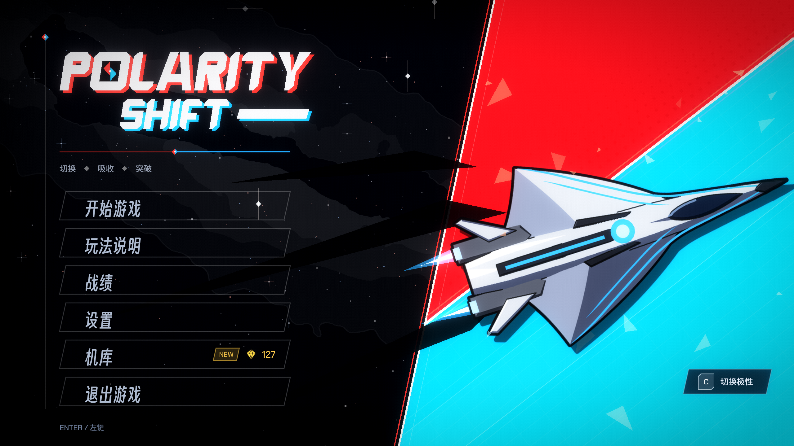

# POLARITY SHIFT

**自機と同じ色の弾は吸収し、違う色の弾は避ける。**

[](https://github.com/DeerXC/POLARITY-SHIFT/actions/workflows/ci.yml)

[English](README.md) | [简体中文](README.zh-CN.md) | 日本語



C++20、Direct3D 11、XAudio2 でゼロから作った 2D 横スクロールシューティングです。約 35,000 行の C++ で、ゲームエンジンは使っていません。外部のコードは `stb_vorbis`（パブリックドメイン）だけです。描画、オーディオエンジン、UI、ゲーム本体のすべてがこのリポジトリに入っています。

## ゲーム内容

自機は**赤か青**で、`C` キーで切り替えます。**同じ色の弾は吸収**してエネルギーに変わり、違う色の弾に当たるとダメージを受けます。エネルギーが満タンになると、装甲を貫通する**白い貫通ビーム**を撃てます。5 つのウェーブの先には 3 フェーズのボス（裁定者 / ARBITER）がいて、各フェーズで問われるのは 1 つだけです。色を読む、位置を読む、時間を読む、の順に進みます。

ウェーブの合間に 15 種類のモジュールから 1 つを選びます（シナジーのあるローグライト要素）。プレイで貯めたシャードは、ハンガーで恒久的なアンロックに使えます。ボスを最初のフェーズから練習できるモードもあります。ゲームは日本語、中国語、英語に対応しています。

| 操作 | キー |
|---|---|
| 移動 | `W` `A` `S` `D` / 矢印キー / マウス |
| ショット | `Space` |
| 極性の切り替え | `C` |
| 貫通ビーム | `V` |
| タクティクス | `Shift` |

キー、マウス、ゲームパッドのボタンは設定で変更できます。

## 技術的なポイント

- **自作レンダラー（Direct3D 11）。** バッチ処理する 2D レンダラーで、プリマルチプライドアルファ、HDR のシーンバッファとデュアルフィルターのブルームを備え、どんな画面比率でもゲーム領域は 16:9 を保ちます。
- **オーディオエンジン（XAudio2）。** 4 本のバスとダッキング、優先度付きのボイス予算、戦闘の激しさで切り替わるレイヤー構成の音楽、自機の色によるクロスフェード、先読みリミッター、オーディオデバイスが失われたときの復旧を実装しています。
- **プログラムで生成した音。** 音楽と 62 個の効果音すべてをスクリプトで生成しています。録音ではありません。3 音のモチーフを曲ごとに変形し、効果音はすべて同じ 5 音（D E G A C）に合わせているので、音楽とぶつかりません。
- **見やすいビーム表現（BeamFx）。** すべての光の線（貫通ビーム、ボスのビームとレーザー、炎の帯）を 1 つのモジュールで描いています。当たり判定の範囲は直線で固定、動くプラズマはその内側に収め、弾より暗くしているため、危険な範囲がいつでも読み取れます。
- **テストできるゲームロジック。** 実際のゲームロジックをウィンドウなしで動かせます。描画、音、入力は代役に置き換えています。ボットが何千回もプレイしてバランスを調整し、ボス、ウェーブ、モジュール、セーブを自動テストで確認します。
- **ローグライト要素。** モジュール、強化、シナジー、タレット付きのハンガー、プレイ履歴付きのセーブ。

詳しくは [ARCHITECTURE.md](ARCHITECTURE.md) を見てください。

## ビルドと実行

必要なもの：Windows 10 / 11（x64）、「C++ によるデスクトップ開発」を入れた Visual Studio 2026（ツールセット v145）、Windows SDK 10.0.26100.0。

1. `GE_06.slnx` を開きます。
2. **x64 / Release** を選び、`F5` を押します。

ビルドでシェーダーのコンパイルと `assets/` のコピーが行われます。ビルドと実行に Python は要りません。生成済みの音は `assets/` に入っています。セーブ（`save.dat`、`history.dat`、`meta.sav`）と `config.ini` は exe の隣に書き込まれます。

## テストとツール

```
make -C tools test        # すべてのテストをビルドして実行
make -C tools sim         # バランスシミュレーター（ボットが 200 回プレイ）
```

テストは Linux の g++ でビルドしています（GitHub Actions も同じ方法で実行します）。Windows では WSL か MSYS2 を使ってください。

音と星空は Python スクリプトで生成します（Python 3.12、`numpy`、`scipy`、`soundfile`。星空には `Pillow`。`ffmpeg` は任意）。音づくりのルールは [tools/audio/README.md](tools/audio/README.md) に書いています。

```
python tools/audio/build_sfx.py --check     # すべての効果音を生成して測定
python tools/audio/build_bgm.py --check     # すべての楽譜を解析
python tools/audio/build_sfx.py             # assets/audio/se に書き出し
python tools/audio/build_bgm.py             # assets/audio/bgm に書き出し（約 8 分）
python tools/make_galaxy.py --png assets/textures/effects/galaxy.png --stars src/game/GalaxyStars.h   # 背景の天の川
```

## ディレクトリ構成

```
src/core    ウィンドウ、Direct3D 11、描画、XAudio2、入力、設定
src/game    自機、敵、ウェーブ、戦闘、エフェクト、シーン
src/boss    3 フェーズのボス
src/rogue   モジュール、成長要素、バランス数値
src/ui      HUD、メニュー、画面遷移
shaders/    HLSL
assets/     テクスチャ、フォント、音楽、効果音、翻訳（中 / 日 / 英）
tools/      テスト、バランスシミュレーター、音・星空・アートの生成ツール
```

## 制作方法

ゲームデザイン、アートの方向性、バランス調整、そしてこのゲームをどんなものにするかというすべての判断は私が行いました。コードは AI アシスタント（Microsoft Copilot）の助けを借りて書いています。作りたいものを私が伝え、返ってきたものをテストして確認し、主な仕組みがなぜそうなっているかをメモに残しました。そのため `tools/` のテストとシミュレーターはこのプロジェクトの大きな部分で、コードが自分の決めたとおりに動くかを確かめる手段になっています。

## クレジットとライセンス

- **ソースコード**（`src/`、`shaders/`、`tools/`）：MIT。[LICENSE](LICENSE) を見てください。
- **アート、音楽、効果音**（フォントを除く `assets/`）：© DeerXC、全著作権を留保します。音楽と効果音は `tools/audio` のスクリプトで生成していて、スクリプトは MIT ですが、生成したファイルは MIT ではありません。
- **フォント**（`assets/fonts`）：Chakra Petch、Dela Gothic One、M PLUS 1、Noto Sans SC、Smiley Sans（得意黒）。それぞれ SIL Open Font License で、ライセンス文は各フォントの隣に置いています。
- **`stb_vorbis`**（`src/third_party`）：パブリックドメイン。作者は Sean Barrett です。
- ビジュアルは『ペルソナ3 リロード』と『ペルソナ5 ザ・ロイヤル』のキービジュアルに着想を得ています。これらの作品のアセット、フォント、ロゴ、音楽は使用しておらず、このプロジェクトは ATLUS、SEGA とは関係ありません。
