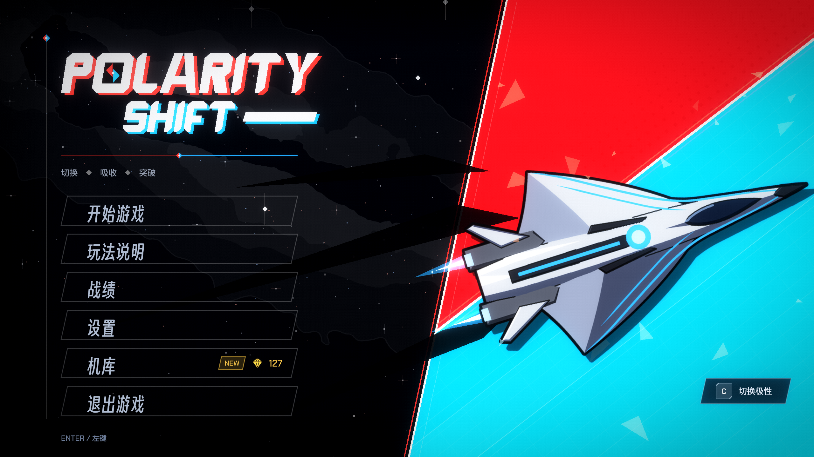

# POLARITY SHIFT

**Absorb the bullets that match your colour. Dodge the ones that don't.**

[](https://github.com/DeerXC/POLARITY-SHIFT/actions/workflows/ci.yml)

English | [简体中文](README.zh-CN.md) | [日本語](README.ja.md)



A 2D horizontal shooter written from scratch in C++20 with Direct3D 11 and XAudio2. About 35,000 lines of C++, no game engine; the only third-party code is `stb_vorbis` (public domain). The renderer, the audio engine, the UI and the game are all in this repository.

## Gameplay

The ship is **red or blue** (`C` switches). A bullet of your colour is **absorbed** and becomes energy; a bullet of the other colour hurts. When the bar is full, the **piercing white beam** goes through armour. Five waves lead to a three-phase boss (ARBITER) that asks one question per phase: read the colour, read the position, read the time.

Between waves you pick one of 15 modules (a roguelite layer with synergies). Shards from a run buy permanent unlocks in the hangar. A boss practice mode starts the fight from the first phase. The game is available in Chinese, Japanese and English.

| Action | Key |
|---|---|
| Move | `W` `A` `S` `D` / arrow keys / mouse |
| Shoot | `Space` |
| Switch polarity | `C` |
| Piercing beam | `V` |
| Tactic | `Shift` |

Keys, mouse and gamepad buttons can be rebound in the settings.

## Engineering highlights

- **Custom renderer (Direct3D 11).** A batched 2D renderer with premultiplied alpha, an HDR scene target with dual-filter bloom, and a 16:9 game area on any screen shape.
- **Audio engine (XAudio2).** Four buses with ducking, a priority-based voice budget, layered music driven by the intensity of the fight, a cross-fade by ship colour, a look-ahead limiter, and recovery when the audio device is lost.
- **Procedurally generated audio.** The music and all 62 sound effects are generated by scripts, not recorded. One three-note motto is transformed for every track, and every effect is tuned to the same five notes (D E G A C), so an effect never clashes with the music.
- **Readable beams (BeamFx).** Every line of light (the piercing beam, the boss's beams, the laser, the band of fire) shares one module. The hit zone is straight and fixed; the animated plasma stays inside it and is dimmer than a bullet, so the danger is always readable.
- **Testable game logic.** The real game logic runs without a window, with stand-ins for rendering, audio and input. A bot plays thousands of runs to balance the game, and automated tests cover the boss, waves, modules and save files.
- **Roguelite systems.** Modules, upgrades, synergies, a hangar with talents, and a save system with a run history.

More detail: [ARCHITECTURE.md](ARCHITECTURE.md).

## Build and play

Requirements: Windows 10 / 11 (x64), Visual Studio 2026 with *Desktop development with C++* (toolset v145), Windows SDK 10.0.26100.0.

1. Open `GE_06.slnx`.
2. Select **x64 / Release** and press `F5`.

The build compiles the shaders and copies `assets/` next to the program. Python is not needed to build or play: the generated audio is already in `assets/`. Saves (`save.dat`, `history.dat`, `meta.sav`) and `config.ini` are written next to the exe.

## Tests and tools

```
make -C tools test        # build and run every test
make -C tools sim         # the balance simulator (200 runs of a bot)
```

The tests build with g++ on Linux (this is what the GitHub Actions workflow runs). On Windows, use WSL or MSYS2.

The audio and the sky are made by Python scripts (Python 3.12, `numpy`, `scipy`, `soundfile`; `Pillow` for the sky; `ffmpeg` is optional). The rules the sound follows are in [tools/audio/README.md](tools/audio/README.md).

```
python tools/audio/build_sfx.py --check     # render and measure every sound effect
python tools/audio/build_bgm.py --check     # analyse every score
python tools/audio/build_sfx.py             # write assets/audio/se
python tools/audio/build_bgm.py             # write assets/audio/bgm (about 8 minutes)
python tools/make_galaxy.py --png assets/textures/effects/galaxy.png --stars src/game/GalaxyStars.h   # the Milky Way of the background
```

## Repository layout

```
src/core    window, Direct3D 11, rendering, XAudio2, input, settings
src/game    player, enemies, waves, combat, effects, scenes
src/boss    the three-phase boss
src/rogue   modules, meta progression, balance numbers
src/ui      HUD, menus, transitions
shaders/    HLSL
assets/     textures, fonts, music, sound effects, translations (zh / ja / en)
tools/      tests, the balance simulator, the audio, sky and art generators
```

## How it was made

I did the game design, the art direction, the balancing and every decision about what the game should be. I wrote the code with an AI assistant (Microsoft Copilot): I explained what I wanted, tested and reviewed what came back, and kept notes on why the main mechanics work the way they do. Because of this, the tests and the simulator in `tools/` are a large part of the project: they are how I check that the code does what I decided.

## Credits and license

- **Source code** (`src/`, `shaders/`, `tools/`): MIT, see [LICENSE](LICENSE).
- **Art, music and sound effects** (`assets/`, except the fonts): © DeerXC, all rights reserved. The music and the sound effects are generated by the scripts in `tools/audio`; the scripts are MIT, the generated files are not.
- **Fonts** (`assets/fonts`): Chakra Petch, Dela Gothic One, M PLUS 1, Noto Sans SC and Smiley Sans, each under the SIL Open Font License. The license text of each font is next to it.
- **`stb_vorbis`** (`src/third_party`): public domain, by Sean Barrett.
- The visual style is inspired by the key art of *Persona 3 Reload* and *Persona 5 Royal*. No asset, font, logo or music of those games is used, and this project is not affiliated with ATLUS or SEGA.
