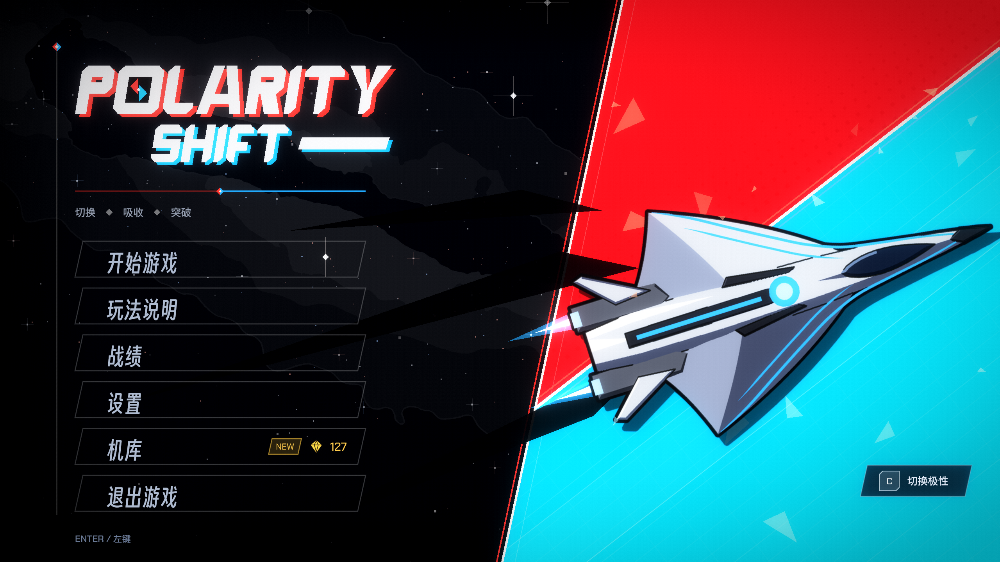

# POLARITY SHIFT

**吸收和你同色的子弹，躲开异色的。**

[](https://github.com/DeerXC/POLARITY-SHIFT/actions/workflows/ci.yml)

[English](README.md) | 简体中文 | [日本語](README.ja.md)



一款从零开始用 C++20、Direct3D 11 和 XAudio2 写成的 2D 横版射击游戏，约 35,000 行 C++，没有使用游戏引擎，唯一的第三方代码是 `stb_vorbis`（公有领域）。渲染器、音频引擎、UI 和游戏本体都在这个仓库里。

## 玩法

飞机是**红色或蓝色**（按 `C` 切换）。**同色的子弹会被吸收**并变成能量，异色的子弹会造成伤害。能量满了，可以释放能穿透装甲的**白色贯穿光束**。五个波次之后是三阶段的 Boss（ARBITER，裁决者），每个阶段只问一个问题：读颜色、读位置、读时间。

波次之间可以从 15 个模块中选一个（带协同效果的 roguelite 层），每局获得的晶片可以在机库里换成永久解锁。另有 Boss 演练模式，直接从第一阶段开始。游戏支持中文、日语和英语。

| 操作 | 按键 |
|---|---|
| 移动 | `W` `A` `S` `D` / 方向键 / 鼠标 |
| 射击 | `Space` |
| 切换极性 | `C` |
| 贯穿光束 | `V` |
| 战术 | `Shift` |

按键、鼠标和手柄按键都可以在设置里改键。

## 技术亮点

- **自写渲染器（Direct3D 11）。** 批处理 2D 渲染器，预乘 Alpha，HDR 场景缓冲加双重滤波泛光，在任意屏幕比例下保持 16:9 的游戏区域。
- **音频引擎（XAudio2）。** 四条总线与闪避、带优先级的声部预算、由战斗强度驱动的分层音乐、按飞机颜色的交叉淡化、前瞻限幅器，以及音频设备丢失后的恢复。
- **程序生成的音频。** 音乐和全部 62 个音效都由脚本生成，不是录制的。同一个三音动机被变形成每一首曲子，每个音效都调到同样的五个音（D E G A C），所以音效不会和音乐冲突。
- **可读的光束（BeamFx）。** 所有"光线"（贯穿光束、Boss 的光束、激光、火焰带）共用一个模块：判定区是笔直固定的，会动的等离子被限制在它里面，并且比子弹暗，所以玩家始终能读出危险范围。
- **可测试的游戏逻辑。** 真实的游戏逻辑不需要窗口就能运行，渲染、音频和输入由替身代替。一个机器人玩家跑几千局来调数值，自动化测试覆盖 Boss、波次、模块和存档。
- **Roguelite 系统。** 模块、升级、协同、带天赋的机库，以及带战绩历史的存档系统。

更多细节见 [ARCHITECTURE.md](ARCHITECTURE.md)。

## 构建与运行

需要：Windows 10 / 11（x64），安装了"使用 C++ 的桌面开发"的 Visual Studio 2026（工具集 v145），Windows SDK 10.0.26100.0。

1. 打开 `GE_06.slnx`。
2. 选择 **x64 / Release**，按 `F5`。

构建会编译着色器，并把 `assets/` 复制到程序旁边。构建和运行都不需要 Python：生成好的音频已经在 `assets/` 里。存档（`save.dat`、`history.dat`、`meta.sav`）和 `config.ini` 写在 exe 旁边。

## 测试与工具

```
make -C tools test        # 构建并运行全部测试
make -C tools sim         # 数值平衡模拟器（机器人跑 200 局）
```

测试用 Linux 上的 g++ 构建（GitHub Actions 就是这么跑的）。在 Windows 上请使用 WSL 或 MSYS2。

音频和星空由 Python 脚本生成（Python 3.12，`numpy`、`scipy`、`soundfile`；星空需要 `Pillow`；`ffmpeg` 可选）。声音遵守的设计规则写在 [tools/audio/README.md](tools/audio/README.md)。

```
python tools/audio/build_sfx.py --check     # 渲染并测量每一个音效
python tools/audio/build_bgm.py --check     # 分析每一首曲子的乐谱
python tools/audio/build_sfx.py             # 写入 assets/audio/se
python tools/audio/build_bgm.py             # 写入 assets/audio/bgm（约 8 分钟）
python tools/make_galaxy.py --png assets/textures/effects/galaxy.png --stars src/game/GalaxyStars.h   # 背景的银河
```

## 目录结构

```
src/core    窗口、Direct3D 11、渲染、XAudio2、输入、设置
src/game    玩家、敌人、波次、战斗、特效、场景
src/boss    三阶段 Boss
src/rogue   模块、成长、数值表
src/ui      HUD、菜单、转场
shaders/    HLSL
assets/     贴图、字体、音乐、音效、翻译（中 / 日 / 英）
tools/      测试、数值模拟器、音频、星空与美术生成器
```

## 制作方式

游戏设计、美术方向、数值平衡，以及这个游戏该是什么样子的所有决定，都由我做出。代码是在 AI 助手（Microsoft Copilot）的协助下写成的：我说明想要什么，测试并审查返回的结果，并记录主要机制为什么这样设计。因此 `tools/` 里的测试和模拟器是这个项目很重要的一部分：它们是我用来确认代码做的事和我的决定一致的方式。

## 致谢与许可

- **源代码**（`src/`、`shaders/`、`tools/`）：MIT，见 [LICENSE](LICENSE)。
- **美术、音乐和音效**（`assets/`，字体除外）：© DeerXC，保留所有权利。音乐和音效由 `tools/audio` 里的脚本生成；脚本是 MIT，生成的文件不是。
- **字体**（`assets/fonts`）：Chakra Petch、Dela Gothic One、M PLUS 1、Noto Sans SC 和得意黑（Smiley Sans），各自使用 SIL Open Font License，许可文本放在每款字体旁边。
- **`stb_vorbis`**（`src/third_party`）：公有领域，作者 Sean Barrett。
- 视觉风格受《女神异闻录 3 Reload》和《女神异闻录 5 皇家版》主视觉的启发。没有使用这些游戏的任何素材、字体、标志或音乐，本项目与 ATLUS 和 SEGA 无关。
